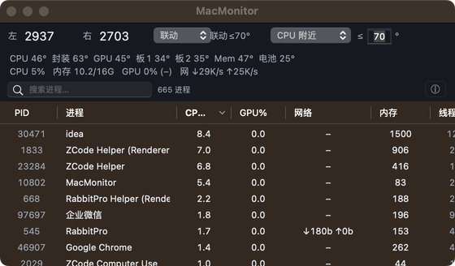

# MacMonitor 🌀

[English](README.md) | [简体中文](README.zh-CN.md)

**macOS system monitor + smart fan control in your menu bar.** Real-time CPU / memory / GPU / network and per-process stats, with three fan modes (auto · constant RPM · sensor-linked). Single native process — ~3% CPU, ~76MB RAM.

> ⚠️ **Fully supports Intel Macs** (macOS 13+). Apple Silicon (M-series) support is in progress.

    

**Keywords**: `mac monitor` `fan control mac` `macos system monitor` `cpu gpu monitor` `process manager` `menu bar app` `temperature monitor` `activity monitor alternative` `smc fan` `intel mac`

## Screenshots

**Menu bar, always live** — fan RPM / CPU / memory / GPU at a glance:


**The panel** — fan control, temps, system stats and the process table (sortable columns, live search, click a row to quit / force-kill):



**About / Tip jar**:


## Features

- **Per-process monitoring** — CPU, GPU, network, memory and threads for every process; sort by any column, live search
- **Force quit any app** — click a row to inspect a process, then quit it gracefully or force-kill it instantly
- **System stats** — CPU, memory, GPUs (iGPU/dGPU utilization), network rates
- **Fan control** — three modes, just like the classics:
  - `Auto` — hand control back to macOS
  - `Constant` — fixed RPM (slider)
  - `Sensor` — pick a sensor + target temperature; RPM ramps linearly from target−12°C, ~60% at target, full speed at +6°C
- **Menu-bar resident** — click any stat row to open the panel; the panel floats above fullscreen apps
- **Single process, native UI** — AppKit panel, no Electron, no WebView; ~3% CPU, ~76MB RAM
- **Auto-update** — checks GitHub Releases daily, one click to download
- **Privacy** — everything is collected and displayed locally; nothing is uploaded

## Install

### Option 1 — Download the DMG (recommended)

Grab `MacMonitor.dmg` from [Releases](../../releases), open it, and drag MacMonitor onto the **Applications** shortcut. Right-click → Open on first launch (the app is unsigned).

First launch asks for two admin permissions:

1. Fan control (authorizes a setuid `smc` helper)
2. Per-process GPU/network sampling (passwordless `powermetrics` / `nettop`)

### Option 2 — From source

```bash
pip install -r requirements.txt

# Fan control helper (GPL, build it yourself; the app works read-only without it)
bash scripts/build-smc.sh

# Optional: enable per-process GPU/network columns
sudo sh -c 'echo "$(whoami) ALL=(root) NOPASSWD: /usr/bin/powermetrics, /usr/bin/nettop" > /etc/sudoers.d/resmon && chmod 440 /etc/sudoers.d/resmon'

python app.py
```

## Building a self-contained .app / DMG

```bash
uv python install 3.12
cp -r "$(uv python find 3.12)" runtime
uv pip install --target site-pkgs -r requirements.txt
cp runtime/bin/python3.12 runtime/bin/MacMonitor
# assemble the .app (Contents/MacOS/MacMonitor is app-launcher.sh), then:
hdiutil create -volname MacMonitor -srcfolder dist -ov -format UDBZ MacMonitor.dmg
```

## Platform notes

| Platform | Status |
|---|---|
| Intel, macOS 13+ | ✅ Fully supported |
| Apple Silicon | ⚠️ Runs under Rosetta; SMC sensor/fan keys differ — adaptation in progress |

## Project layout

```
app.py             entry point: menu-bar app + single-process assembly
panel.py           native AppKit panel (fan control / temps / process table)
server.py          backend: process/GPU/network sampling, SMC fan control, local HTTP API
app-launcher.sh    .app launcher (self-contained runtime + first-run authorization)
web/index.html     legacy browser UI (debug, 127.0.0.1:8765)
scripts/           smc helper build script
```

## Credits

- [smcFanControl](https://github.com/hholtmann/smcFanControl) — the SMC read/write helper (GPL)
- [rumps](https://github.com/jaraco/rumps) · [psutil](https://github.com/giampaolo/psutil) · [PyObjC](https://github.com/ronaldoussoren/pyobjc)

## License

[MIT](LICENSE) — the `smc` helper itself is GPL (upstream) and is built separately, not included in this repo.

## Support the project

If MacMonitor helps you, consider buying the author a coffee ☕️ — scan the QR code in the app's About window (or below).


